  

  

  
  
  

---

AI Engineer who builds things that make developers' lives easier, so you can spend less time on boring stuff and more time on the fun parts.

🤖 Teaching machines to do the tedious work 
🛠️ Making developers' lives easy, one tool at a time 
☁️ Cloud engineer on the side 
⚡ Focused on: building efficient, scalable, AI-powered tools 
🐛 Fixing bugs I created five minutes ago 
☕ Powered by caffeine and "just one more commit"

  

  
  

<picture>
  <source media="(prefers-color-scheme: dark)" srcset="https://raw.githubusercontent.com/Ganesh-M01/Ganesh-M01/output/github-snake-dark.svg" />
  <source media="(prefers-color-scheme: light)" srcset="https://raw.githubusercontent.com/Ganesh-M01/Ganesh-M01/output/github-snake.svg" />
  
</picture>

Got an AI idea, a workflow that needs automating, or a dev headache that needs fixing? Hit me up. I don't bite (much).

  

