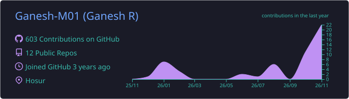
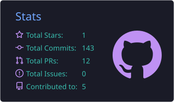
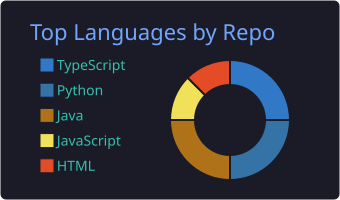
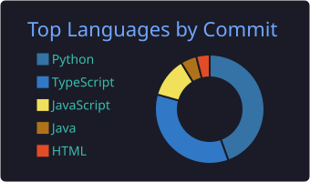
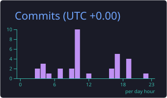

  

  

  
  
  

---

AI Engineer who builds things that make developers' lives easier, so you can spend less time on boring stuff and more time on the fun parts.

🤖 Teaching machines to do the tedious work 
🛠️ Making developers' lives easy, one tool at a time 
☁️ Cloud engineer on the side 
⚡ Focused on: building efficient, scalable, AI-powered tools 
🐛 Fixing bugs I created five minutes ago 
☕ Powered by caffeine and "just one more commit"

<table>
  <tr>
    <td align="center" width="190"><b>🔮 Main Magic</b> AI &amp; ML · my specialty</td>
    <td></td>
  </tr>
  <tr>
    <td align="center"><b>⚔️ Everyday Weapons</b> languages I swing daily</td>
    <td></td>
  </tr>
  <tr>
    <td align="center"><b>🏰 Castle Building</b> web &amp; backend</td>
    <td></td>
  </tr>
  <tr>
    <td align="center"><b>📦 Treasure Vaults</b> where the data sleeps</td>
    <td></td>
  </tr>
  <tr>
    <td align="center"><b>🚀 Teleport Spells</b> ship it &amp; deploy it</td>
    <td></td>
  </tr>
</table>

  <i>Currently grinding XP in: LLM apps · AI agents · cloud deployment</i> ✨

  <i>Stats refresh automatically every day. Numbers don't lie (but they do wobble).</i>

  
  

  
  

  
  

  <i>It eats my contributions one commit at a time. Feed it more.</i> 🐍

  <picture>
    <source media="(prefers-color-scheme: dark)" srcset="https://raw.githubusercontent.com/Ganesh-M01/Ganesh-M01/output/github-snake-dark.svg" />
    <source media="(prefers-color-scheme: light)" srcset="https://raw.githubusercontent.com/Ganesh-M01/Ganesh-M01/output/github-snake.svg" />
    
  </picture>

  Got an AI idea, a workflow that needs automating, or a dev headache that needs fixing? 
  Pin your quest to the board. I don't bite (much).

  

  
  
  

